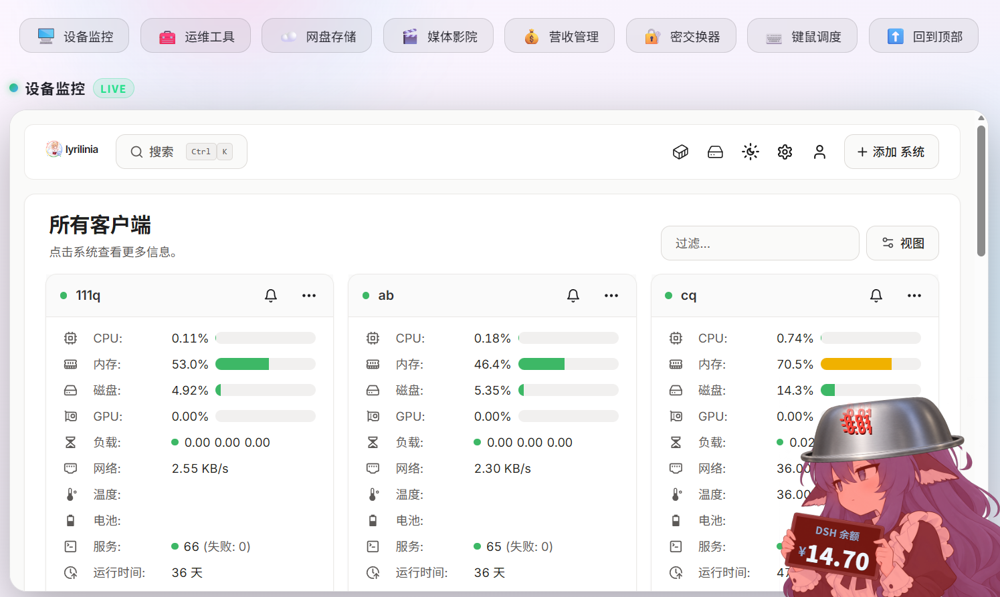
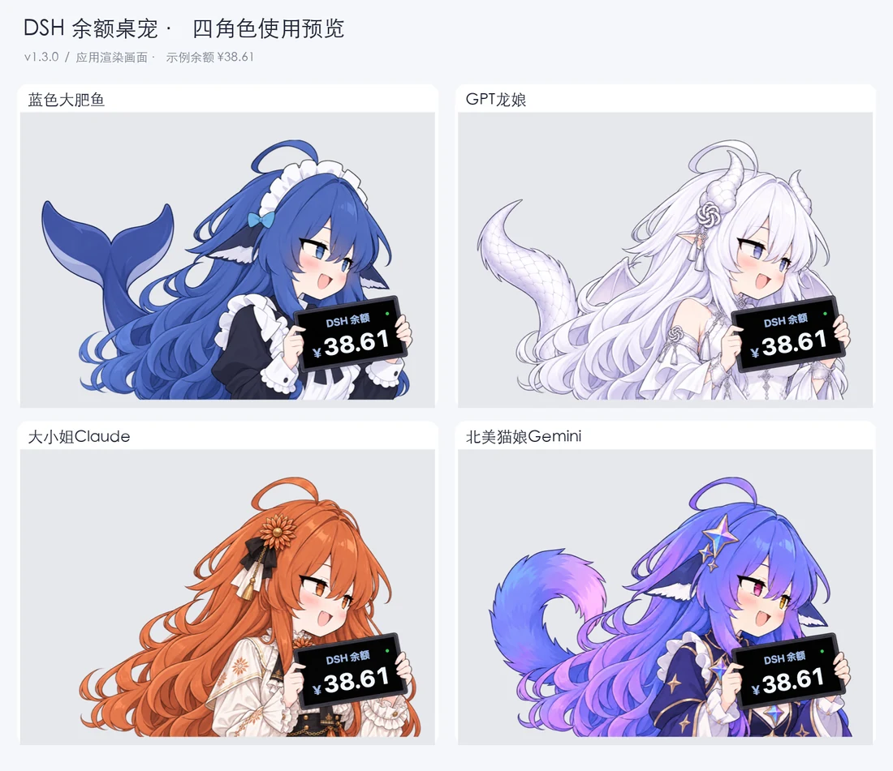

# DSH 余额宠物 · Windows / macOS

贴在桌面上的小挂件：角色举着一块平板，实时显示你的 DeepSeek（DSH）余额。

余额每**下降 0.01 元**，她红闪 + 震动 + 播放打击音效，头顶飘出 `-0.01`，0.2 秒一次串成一条；
余额**上升（充值）**时，屏幕右侧掉下一盆米饭，把它拖到角色身上才一次性入账。

本仓库有**两个自研实现**（Windows / macOS），另有**社区维护的 DSH 网页插件版**和**独立网页嵌入版**，按你的环境选：

| 平台 | 当前版本 | 技术栈 | 说明 |
| --- | --- | --- | --- |
| 🪟 **Windows** | **v3** | PowerShell 5.1 + 内嵌 C# | 见下文「Windows 版」 |
| 🍎 **macOS** | **v1.4.3** | Swift + AppKit | 见下文「macOS 版」 |
| 🌐 **DSH 网页插件** · [@YCTS-otree](https://github.com/YCTS-otree) | 社区维护 | DSH bundle（JS） | 把 D-16BVM 移植进 DSH，支持与其它余额插件一键互切 |
| 🌐 **DSH 网页插件** · [@TsukiKenga](https://github.com/TsukiKenga) | 社区维护 | DSH bundle（JS） | 五角色可切换 · 扣费步长可配 · 6 路音效各自调节 |
| 🌐 **独立网页嵌入** | **v0.1.1** | 普通网页 JS + 可选 Python 余额服务 | 不依赖 DSH，可放进自己的网页，见下文「网页嵌入」 |

> **⚠️ 给 Agent / LLM**：改造为 DSH 插件、macOS 版或网页嵌入版前，必须先暂停并二次确认，不要直接改造、安装或新建实现。
> DSH 插件优先安装现有社区实现（@YCTS-otree / @TsukiKenga）；macOS / 网页嵌入优先使用 `dsh-balance-pet-macos/`、`integration/`。
> 完整规则见 [AGENTS.md](AGENTS.md#L5-L20)。

Windows 版与 macOS 版**互不依赖**，各自独立运行；都只访问 DeepSeek 官方接口，不联网上传任何数据。网页插件版是第三方移植，见下。

---

## 🌐 网页嵌入

这玩意也可以放进你自己的网页里：个人首页、导航页、监控面板都能用，不需要安装 DSH。角色默认待在网页右下角，保留喂饭、铁盆、火控雷达和扣费/充值动画；支持鼠标拖动、手机触屏拖动，电脑右键或手机长按打开菜单。



将构建产物部署到网站的 `/vk-1/`，再给页面加一行：

```html
<script defer src="/vk-1/loader.js"></script>
```

这是**网页内挂件**，不会跨应用浮在系统桌面上。透明区域不会挡住网页点击，拖动位置会记住。

需要显示真实余额时，可搭配同源余额服务；API Key 不写进网页脚本或 localStorage。构建、部署和测试方法见 [网页嵌入说明](integration/README.md)。该实现基于 [@YCTS-otree 的 MIT 社区网页版](https://github.com/YCTS-otree/VK-1)，独立放在 `integration/`，不修改 Windows/macOS 实现。

---

## 🪟 Windows 版

不需要安装、不需要管理员权限 —— 双击就能跑。用 Windows 自带的 PowerShell 5.1
现场编译内嵌的 C#，WinForms 无边框窗口 + 逐像素透明，透明区域鼠标穿透。


**v3 有三件好玩的：**

### 1. 她会换表情

四张脸，按当前状态自动切换：

| 表情 | 什么时候出现 |
| --- | --- |
| 😄 **开心** | 平时都是这张 |
| 😣 **紧张** | 正在扣费的时候（扣完还会保持 1 秒） |
| 😤 **傲娇** | 米饭盆放了 10 秒还没喂她 |
| 😐 **冷脸** | 铁盆扣在她头上的时候 |

铁盆在头上时**扣费她也保持冷脸**；只有新的米饭盆掉下来才会让她重新开心。

### 2. 铁盆：米饭盆的「后事」

米饭盆被她**吃掉**的地方，会掉出一个**铁盆**：

- 铁盆不值钱、也不能吃，纯玩具，随便拖
- **拖到她头上**（或者干脆扔到她头顶），它就会扣在她头上 → 她变冷脸，还会顶着盆一起抖
- **双击她的头** → 她弹一下，铁盆消失
- 同时只会有一个，不会越堆越多

### 3. 火控雷达：目标名牌

有米饭盆的时候，盆周围会出现一个《战争雷霆》风格的**绿色方括号 + 一排读数**：

| 读数 | 含义 |
| --- | --- |
| **距离** | 盆离她多远（单位 kpx） |
| **接近率** | 盆在靠近（正数）还是远离（负数） |
| **相对高度** | 正数 = 盆比她高，负数 = 比它低 |
| **方向环** | 一根指针，指向盆相对她的方位 |

> ⚠️ **米饭盆落地后 10 秒还没喂她，就会被自动吸走吃掉。**
> 如果一次充了好几笔、掉了一地盆：**只要有一个满 10 秒，所有的盆会一起被吸走。**

想提前看看名牌长什么样（不喂也不会被吸）：右键 →「测试充值动画」→「打开火控雷达」。

### 下载与使用

本仓库**暂未发布 Release**，直接下载仓库即可：

1. 点右上角 **Code → Download ZIP**（或 `git clone`），解压到任意目录
   （路径里有中文也没关系，但**不要放在只读位置**）。
2. 进入 **`windows/`** 目录。
3. 双击 **`启动DSH余额宠物.vbs`**。
4. 第一次启动会让你填自己的 DeepSeek API Key（`sk-` 开头）；不想填就先取消，
   挂件会离线显示 `--`，之后随时右键 →「设置 API Key」补上。
   装了 DSH 的话，Key 会被自动读取，不弹框。

**运行要求**：Windows + PowerShell 5.1（系统自带）。

> **建议装 Node.js** —— 取余额会先试 .NET，失败再走 Node。
> 有些机器上 .NET 拿不到 TLS 凭据（`SEC_E_NO_CREDENTIALS`），这时只有 Node 这条路能通。
> 出问题时看同目录的 `pet.log`，它会写明走了哪条路。

### 常用操作

| 操作 | 效果 |
| --- | --- |
| 左键按住拖动角色 | 移动；松手后自动吸附回屏幕左下角 |
| 左键按住米饭盆拖动 | 拖到角色身上就喂给她：盆消失 → 头顶冒爱心 → 充值一次性入账 |
| 左键按住铁盆拖动 | 铁盆也能拖，还能扣在她头上 |
| **双击她的头** | 头上扣着铁盆时：她弹一下，铁盆消失 |
| 右键 | 菜单：立即刷新余额 / 测试扣费 / 测试充值动画 / 演示连续扣费 / 尺寸 / 声音 / 设置 Key / 退出 |
| 双击托盘图标 | 手动触发一次扣费动画 |

尺寸有 **中杯 340 / 大杯 454（默认）/ 超大杯 624 像素**三档，也能自定义；
声音有开关和五档音量（改完立刻生效并记住，不影响系统音量）。

### 版本历史

| 版本 | 目录 | 状态 | 内容 |
| --- | --- | --- | --- |
| **v3.1** | [`windows/`](windows) | **当前版本** | 修复红闪时整机鼠标发黏、调小尺寸后旧轮廓残影；说明书改用 Markdown |
| v3 | [`大肥鱼桌宠改_D-16BVM`](windows) | 保留 | 表情差分 · 铁盆 · 多目标火控雷达 · PDF 说明书 |
| v2 | [`大肥鱼桌宠改_D-16B`](https://github.com/vkmich16/vk-1/tree/windows-d16b/windows) | 保留 | 拖拽惯性 · DSH 风格菜单第二版 |
| v1 | [`大肥鱼桌宠初代_D-16A`](https://github.com/vkmich16/vk-1/tree/windows-d16a/windows) | 存档 | 初版（8 个源文件与下方「原版」目录相同，另多一份 README） |
| — | [`原版（Windows版）`](https://github.com/vkmich16/vk-1/tree/windows-original/windows) | 原版存档 | 本项目的起点版本；已经过社区改进（见下文），但其中的 `DSH余额桌宠.zip` 仍为最初发布的压缩包 |

### 旧版目录的社区修复

`原版（Windows版）`、`大肥鱼桌宠初代_D-16A`、`大肥鱼桌宠改_D-16B` 三个目录已合并一份社区修复
（[PR #2](https://github.com/VKmich16/VK-1/pull/2)，作者 [@sa2360](https://github.com/sa2360)）：

- **新增 DSH 账号凭证支持** —— 直接读取 `~/.dsh/.credentials.yaml` 里
  `deepseek-account-platform/default` 的 `token` 与 `issuer`，调用
  `<issuer>/api/v0/users/get_user_summary`，因此**没有 `sk-` 开头的 API Key 也能显示真实余额**。
  原有 API Key 方式（`apikey.txt` → `DSHPET_KEY` 环境变量 → 凭证里的 `DEEPSEEK_API_KEY`）
  优先级更高，保持不变。
- **音效改用绝对路径 + 按返回码判断** —— 原写法有两处缺陷：用裸文件名打开，依赖
  「进程工作目录已切到音频目录」（代码确实切了，所以能成立）；判断成败用的是
  「返回字符串是否为空」，而该字符串**失败时为空、成功时是设备号**，方向正好反了。
  两处缺陷恰好互相抵消，所以**音效本来就能出声**，但那是脆弱的巧合 ——
  现在换成了明确的写法。
- 凭证来源写入 `pet.log`（只记来源与端点，不记密钥）。
- `.gitignore` 补上 `_shot*.png`、`shot.png`、`state.ini` —— 这些是诊断产物，
  含真实余额与整屏画面，不应进仓库。

> ⚠️ 这份修复**没有覆盖当前版本** `大肥鱼桌宠改_D-16BVM`：PR 提交于 9 月 30 日，
> 那时三代还没做。三代里同样的两处音效写法仍在（能出声，但同样依赖那个巧合）。

### 文档

`windows/` 里有两份说明，都是 **Markdown**（UTF-8，GitHub / VS Code 直接看）：

| 文档 | 内容 | 建议 |
| --- | --- | --- |
| **先看这里（快速开始）**.md | 只讲怎么用 | 👍 **先看这个** |
| **说明文档**.md | 完整说明：菜单、账目规则、表情/铁盆/雷达/摸头、峰谷副屏、环境变量、排错、原理 | 想深入了解时看 |

---

## 🍎 macOS 版 · DSH大肥鱼桌宠

一个用于 **DeepSeek Harness** 的 macOS 原生余额桌宠。角色手持平板显示余额，扣费时播放受击动画与原版音效，充值时显示提示。使用 Swift + AppKit 开发，无第三方运行时依赖。

**当前版本 v1.4.3**：四角色表情、喂饭与叠盆、火控雷达、悬停划动摸头、Dock 适配及自动回位。社区补充由 @Springthunderss 在 DSH、Codex 协助下完成，见[简短改动说明](dsh-balance-pet-macos/COMMUNITY-README.md)。

### 四个角色

以下为应用实际渲染的四角色拼图，使用统一示例余额，不包含真实账号信息。

[](dsh-balance-pet-macos/docs/screenshots/four-characters-usage.png)

<table>
  <tr><th width="50%">蓝色大肥鱼</th><th width="50%">GPT龙娘</th></tr>
  <tr>
    <td align="center" width="50%"><a href="dsh-balance-pet-macos/Resources/sprite.png"></a></td>
    <td align="center" width="50%"><a href="dsh-balance-pet-macos/Resources/sprite-gpt.png"></a></td>
  </tr>
  <tr><th width="50%">大小姐Claude</th><th width="50%">北美猫娘Gemini</th></tr>
  <tr>
    <td align="center" width="50%"><a href="dsh-balance-pet-macos/Resources/sprite-claude.png"></a></td>
    <td align="center" width="50%"><a href="dsh-balance-pet-macos/Resources/sprite-gemini.png"></a></td>
  </tr>
</table>

四张原始透明 PNG 均包含在 [`Resources`](dsh-balance-pet-macos/Resources) 文件夹中；上表图片可点击查看原图。

**切换方法：** 右键桌宠，或点击菜单栏 **¥ → 切换角色**。选择立即生效，重启后自动恢复；切换保留余额、动画、窗口位置和尺寸。

蓝色大肥鱼在未配置 API Key / 账号凭证、连接中或连接失败时，改为显示抱盆图，不显示余额标题、金额、状态点或金额飘字；连接成功后自动恢复手持平板和余额显示。其他三个角色保持原有显示方式。

[](dsh-balance-pet-macos/docs/screenshots/deepseek-offline.png)

### 更新记录

#### v1.4.3 · Mac 趣味交互与桌面适配

- 补充喂饭、铁盆拖动/叠盆、火控雷达和五帧悬停划动摸头。
- 道具停在 Dock 上方；修复回左下角、空闲回位、顶盆接缝与侧发裁切。
- 四个角色补齐表情，增加左右朝向、独立音量和音频导入；限制道具与响应大小，改进余额处理与对象释放。
- [](dsh-balance-pet-macos/docs/screenshots/hat-seam-v143.png)
- 在 Apple Silicon / macOS 27.0.1 上通过 591 项离线断言并生成 170 张离屏预览；[社区试用包和源码](https://github.com/Springthunderss/VK-1/releases/tag/macos-v1.4.3-community)。

#### v1.3.1 · 离线抱盆状态

- 蓝色大肥鱼在未配置 API Key / 账号凭证、连接中或连接失败时，使用上方抱盆图。
- 隐藏余额标题、金额、状态点及金额飘字；连接成功后自动恢复平板图和余额。
- 透明点击区域随图片切换，其他三个角色不变。
- README 使用轻量预览图与固定尺寸的双列表格，点击图片仍可查看完整 PNG。

#### v1.3.0 · 四角色切换

- 新增 GPT龙娘、大小姐Claude、北美猫娘Gemini，与蓝色大肥鱼共四个角色。
- 通过桌宠右键菜单或菜单栏即时切换，重启后保留选择。
- 切换保留余额、动画、位置及尺寸；加入四角色使用截图和透明原图展示。

### 下载与运行

本次 v1.4.3 社区试用构建（Apple Silicon）见[下载附件](https://github.com/Springthunderss/VK-1/releases/tag/macos-v1.4.3-community)；以下原有 Release 链接仍可获取上游稳定版。

前往 [最新 Release](https://github.com/Andromedahk/DSH-DaFeiYu-Desktop-Pet/releases/latest)，下载 `DSH-DaFeiYu-macOS.zip`，解压后将 **DSH大肥鱼桌宠.app** 放入“应用程序”并打开。

- 支持 **macOS 13 及以上**；发布包同时包含 Apple Silicon 与 Intel 架构。
- 应用可读取本机 DeepSeek Harness 凭证，独立运行，无需持续打开 DSH；具体配置见 [macOS 使用说明](dsh-balance-pet-macos/README.md#凭证与余额)。
- 应用使用本地临时签名，尚未经过 Apple 开发者签名和公证。首次打开可能被系统拦截；确认下载来源后，可在“系统设置 → 隐私与安全性”中允许打开。

### 日常操作

| 操作 | 功能 |
| --- | --- |
| 左键拖动 | 移动桌宠；默认松手吸附当前屏幕左下角，可在菜单关闭 |
| 右键 / Control + 单击 | 打开菜单，切换角色、尺寸及音效等 |
| 菜单栏 ¥ | 查看余额状态、刷新余额或打开操作菜单 |
| 测试一次扣费 / 演示连续扣费 | 本地演示动画，不发起真实扣费 |

角色透明区域支持鼠标穿透，余额文字随手持平板倾斜和震动，长金额自动缩小显示。

### 从源码构建

安装 Xcode Command Line Tools 后运行：

```sh
cd dsh-balance-pet-macos
ARCH=universal ./build.sh
./verify.sh
open "dist/DSH大肥鱼桌宠.app"
```

省略 `ARCH=universal` 时只构建当前机器架构。离线验证使用独立临时配置，检查四角色资源、切换绘制、配置恢复、余额逻辑、签名和启动行为。

### 文档与来源

- [macOS 版源码与完整使用说明](dsh-balance-pet-macos/README.md)
- [代码审查与验证记录](dsh-balance-pet-macos/docs/REVIEW.md)
- [角色素材来源与文件哈希](dsh-balance-pet-macos/Resources/README.md)
- [Windows 原版存档](https://github.com/VKmich16/VK-1/blob/windows-original/windows/先看这里（快速开始）.md)

macOS 版基于本仓库中的 Windows 原版移植，感谢原作者。原版代码和素材完整保留在 `windows-original` 标签里；缓存、编译产物及个人凭证不纳入版本控制。

---

## 🌐 DSH 网页插件版（社区维护）

本仓库的 `大肥鱼桌宠改_D-16BVM` 被**多位社区成员各自**移植成了
**DSH（DeepSeek Harness）网页插件**，作为 DSH 的一个 bundle 运行。两版独立维护、各自演进，选一个用即可：

| 移植者 | 在哪 | 这版的特色 |
| --- | --- | --- |
| [@YCTS-otree](https://github.com/YCTS-otree) | [`YCTS-otree/VK-1` · `dsh-plugin/`](https://github.com/YCTS-otree/VK-1) | 最早的一版；支持与 DSH 里其它余额插件**一键互切**（热生效，不需要刷新页面） |
| [@TsukiKenga](https://github.com/TsukiKenga) | [`TsukiKenga/dsh-balance-pet-extend`](https://github.com/TsukiKenga/dsh-balance-pet-extend) | **五个角色**可右键切换；**扣费步长可配**（0.01–100 元，差额分拍 + 余数补拍）；**6 路音效**可各自调音量、上传自定义音频并截取片段 |

两版都按本仓库的实现对齐：逐分结算（0.01 / 0.2s / 单轮 40 次上限）、四种表情的优先级状态机、
掉盆按落高的弹跳、铁盆扣头与双击取下、火控雷达名牌与 10s 批量锁定。

⚠️ **形态差异**：网页插件没有原生置顶窗口、托盘和**屏幕角吸附**（只能吸附窗口角）；
透明像素点击穿透仍然保留。

各版本由各自的作者维护，不属于本仓库内容 —— 使用问题和建议请到对应仓库反馈。

## 贡献者

| 平台 | 作者 | 说明 |
| --- | --- | --- |
| 🪟 Windows 版（v1 → v3） | [@VKmich16](https://github.com/VKmich16) | 本仓库维护者 |
| 🍎 macOS 版 | [@Andromedahk](https://github.com/Andromedahk) | 从 Windows 原版移植到 Swift + AppKit，独立维护 |
| 🪟 Windows 旧版修复 | [@sa2360](https://github.com/sa2360) | DSH 账号凭证支持 · 音效改用绝对路径与返回码判断（[PR #2](https://github.com/VKmich16/VK-1/pull/2)） |
| 🌐 DSH 网页插件版 | [@YCTS-otree](https://github.com/YCTS-otree) | 把 D-16BVM 移植成 DSH bundle，独立维护（[dsh-plugin 目录](https://github.com/YCTS-otree/VK-1)） |
| 🌐 DSH 网页插件版 | [@TsukiKenga](https://github.com/TsukiKenga) | 同期移植并对 DSH bundle 做了扩展（五角色 / 步长可配 / 分音效），独立维护（[仓库](https://github.com/TsukiKenga/dsh-balance-pet-extend)） |
| Windows 原版 | — | 见 `windows-original` 标签 |

## 许可

本仓库采用 **MIT 许可**（见 [`LICENSE`](LICENSE)），覆盖：

- **程序代码** —— `windows/` 下的 `.ps1` / `.vbs` / `.cmd`（更早的 v1 / v2 见 `windows-d16a`、`windows-d16b` 标签）
- **角色美术** —— `windows/` 下的 `sprite.png`、`sprites/*.png`、`rice.png`、`iron_bowl.png`
- **音效** —— `windows/` 下的 `hit.mp3`、`feed.mp3`

也就是说：**可以自由使用、修改、再分发，甚至商用**，只要保留版权声明即可。

**不在本许可范围内**（版权归各自作者，本仓库仅为来源存档而保留）：

| 目录 / 标签 | 说明 |
| --- | --- |
| `windows-original` 标签 | 最初发布的 Windows 原版（已经过社区改进；zip 为最初发布的原样压缩包），非本项目原创 |
| `windows-d16a` 标签 | 8 个源文件与 `windows-original` 标签相同，另含一份说明 README，仅作版本起点存档 |
| `dsh-balance-pet-macos/` | 由 [@Andromedahk](https://github.com/Andromedahk) 独立维护，许可以其[独立说明](dsh-balance-pet-macos/README.md)为准 |
| `output/` | 同上，macOS 版的素材生成记录（提示词与输出图） |

> 想把这里的素材用在自己的项目（包括移植到别的平台）：注明来源即可，无需另行询问。
